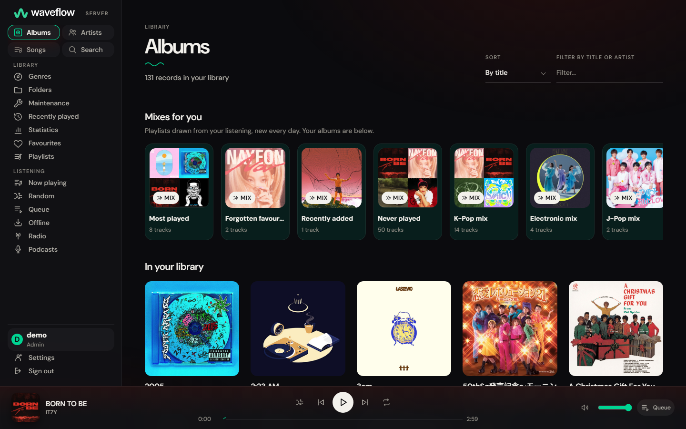
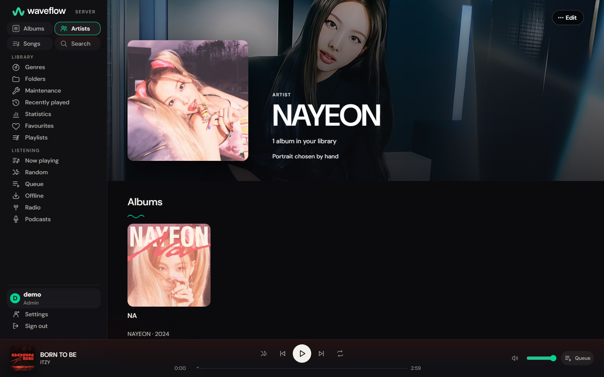
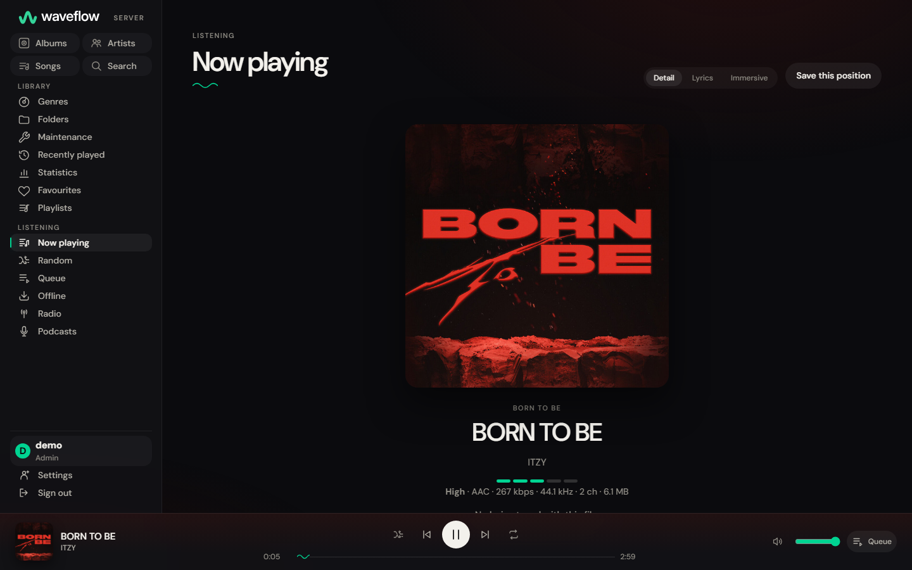
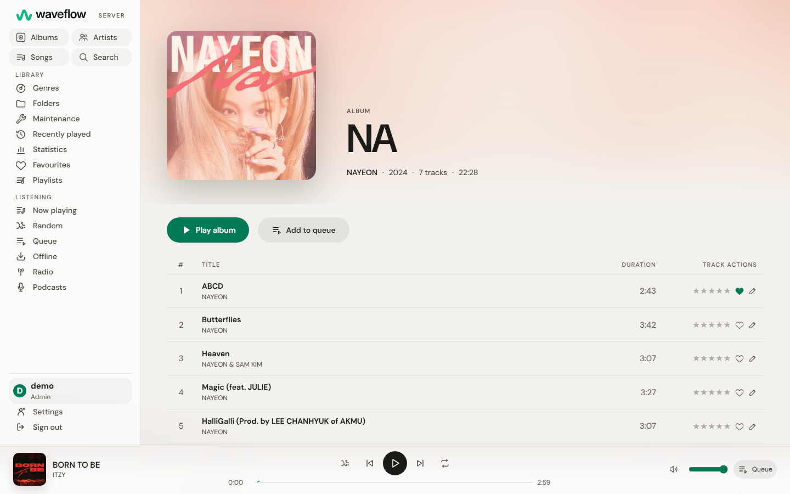
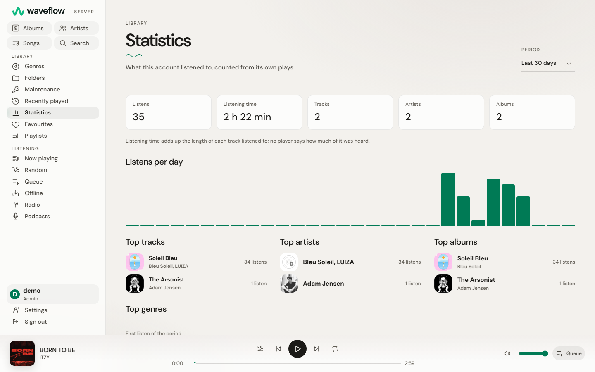
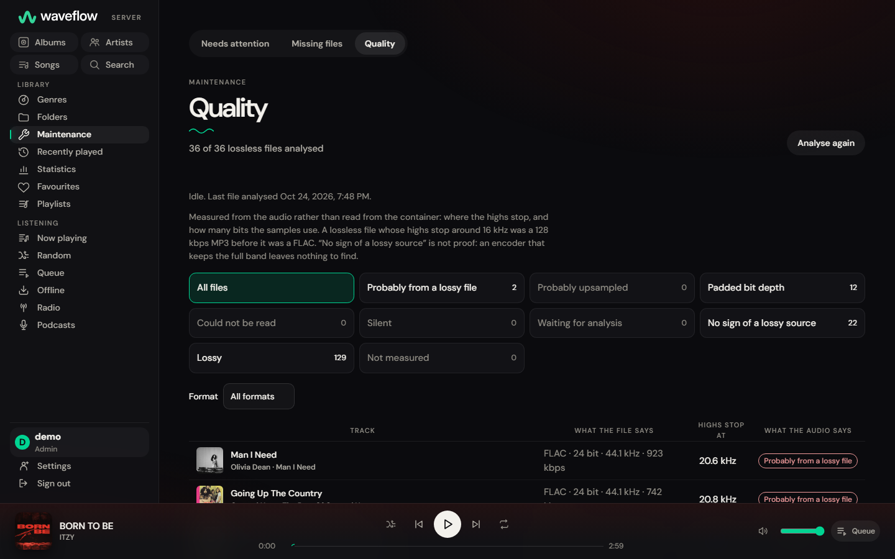

<!-- markdownlint-disable MD033 MD041 -->
<h1 align="center">
  <picture>
    <source media="(prefers-color-scheme: dark)" srcset="https://raw.githubusercontent.com/InstaZDLL/waveflow-server/main/assets/waveflow-server-logo-horizontal-dark.svg" />
    
  </picture>
</h1>

<p align="center">
  <strong>Your music, everywhere you listen.</strong>
  <br />
  A self-hosted music server in one Rust binary — with a web player built in, and the OpenSubsonic API your apps already speak.
</p>

<p align="center">
  
  
  
  
  
  
</p>

<p align="center">
  Point WaveFlow Server at the folders where your music lives. It builds your library, streams it to your browser,
  your phone and your desktop, and converts on the fly when the connection is tight.
  <br />
  No PostgreSQL, no Redis, no identity provider: <b>one binary, one database file, one key file.</b>
  <br />
  <strong>Your files. Your server. Every player.</strong>
</p>

<p align="center">
  <a href="#install"><b>Install</b></a>
  &nbsp;·&nbsp;
  <a href="#features"><b>Features</b></a>
  &nbsp;·&nbsp;
  <a href="#screenshots"><b>Screenshots</b></a>
  &nbsp;·&nbsp;
  <a href="#works-with-your-apps"><b>Apps</b></a>
  &nbsp;·&nbsp;
  <a href="docs/README.md"><b>Documentation</b></a>
  &nbsp;·&nbsp;
  <a href="#development"><b>Develop</b></a>
</p>

<p align="center">
  
  <br />
  <sub><b>The web player</b> · your library, with mixes made from what you actually listen to</sub>
</p>

---

## Why WaveFlow Server

<table>
  <tr>
    <td>📦&nbsp;<b>Up in a minute</b></td>
    <td>One container, on a server, a NAS or a Raspberry Pi 4 or 5. The catalogue lives in a single SQLite file, kept with its key: back up the two together, with the artwork, canvas and podcast folders beside them, as the <a href="docs/guides/operations.md#back-up-two-files-together">operations guide</a> explains.</td>
  </tr>
  <tr>
    <td>📱&nbsp;<b>Your apps already work</b></td>
    <td>Subsonic players connect as they are, with no plugin. Symfonium, Feishin, DSub and Juliet have each been run against the server, and the <a href="docs/compatibility/subsonic-compatibility.md">dated results</a> are published, limits included.</td>
  </tr>
  <tr>
    <td>🌐&nbsp;<b>A player in the browser</b></td>
    <td>No app to install: open the server's address and listen, on a desktop or a phone, and keep tracks for when you are offline.</td>
  </tr>
  <tr>
    <td>🔁&nbsp;<b>Nothing moves under you</b></td>
    <td>Album and artist IDs are derived from your tags, so rebuilding the catalogue gives the same IDs back: the links and references your apps hold keep working.</td>
  </tr>
  <tr>
    <td>🔍&nbsp;<b>Knows what your files really are</b></td>
    <td>The audio of every lossless file is measured, and a FLAC that was once an MP3 is shown for what it is.</td>
  </tr>
  <tr>
    <td>🛡️&nbsp;<b>Yours, and only yours</b></td>
    <td>Your audio files are never rewritten. Nothing leaves the server unless you switch it on, and <a href="docs/guides/privacy.md">every outbound request is listed</a>.</td>
  </tr>
</table>

## Features

### 🎧 Listening

- **A complete web player** compiled into the server: albums, artists, songs, genres, folders, search as you type, queue, history and favourites.
- **Mixes** made from your own listening, **listening statistics**, and **similar songs** drawn from your library.
- **Synced lyrics** from the files or their `.lrc`, with a full-screen immersive view; LRCLIB fills the gaps once you switch it on.
- **Streams the original**, or converts on the fly to MP3, Opus or AAC, with seeking inside a conversion and server-side volume levelling (ReplayGain).
- **Offline listening** for the tracks you keep, installable as an app on a phone, keyboard shortcuts, media keys and lock-screen controls.
- **14 themes**, light and dark, in nine languages: English, French, German, Spanish, Italian, Japanese, Korean, and Simplified and Traditional Chinese.

### 📚 Your library

- **Scans quickly and keeps up**: only what changed is read again, one damaged folder does not stop the rest, and a watcher picks up new files as they land.
- **Tags or folders**: browse by album and artist, or by the folders on your disk.
- **Thirteen credit roles** (composer, producer, featured artist…), and a joined credit like `Artist A, Artist B` split into two artists when you decide it should be.
- **Missing files keep their data**: favourites, ratings and plays wait for the file to come back. A purge can be undone for a week.
- **Uploads**: a library can accept files sent from a client.

### ✨ Discovery

- **Artist pages** with biographies and similar artists from Last.fm, portraits from Deezer and fanart banners from TheAudioDB, once you opt in.
- **Choose the portrait and the banner yourself**, or let the server find a banner.
- **Smart playlists** that fill themselves from rules, **internet radio** and **podcasts**.

### 📋 Playlists and sharing

- Playlists with repeats, **public playlists** for the other accounts, and **`.m3u` import and export**.
- **Share links** that open a player page in any browser, with an optional expiry and visit limit.
- **Scrobbling** to ListenBrainz, Last.fm and Maloja, through a durable queue that survives restarts and retries a service that is down.

### 🔒 Accounts and safety

- **Several accounts**, each seeing only the libraries it belongs to.
- Argon2id passwords, tokens stored only as hashes, the Subsonic password encrypted with a local key, and sign-in protected against guessing.
- A one-time token guards the first-run setup, so a stranger cannot claim a fresh server.
- **Backups**: `waveflow-server database backup` copies the database and its key together, and the server makes a copy of both before every upgrade.

## Screenshots

<table>
  <tr>
    <td width="50%"></td>
    <td width="50%"></td>
  </tr>
  <tr>
    <td align="center"><sub><b>Artist</b> · a portrait and a banner, chosen or found</sub></td>
    <td align="center"><sub><b>Now playing</b> · with what is actually being streamed</sub></td>
  </tr>
  <tr>
    <td width="50%"></td>
    <td width="50%"></td>
  </tr>
  <tr>
    <td align="center"><sub><b>Album</b> · in one of the light themes</sub></td>
    <td align="center"><sub><b>Statistics</b> · counted from your own plays</sub></td>
  </tr>
  <tr>
    <td colspan="2" align="center"></td>
  </tr>
  <tr>
    <td colspan="2" align="center"><sub><b>Quality</b> · every lossless file measured, not taken at its word</sub></td>
  </tr>
</table>

## Install

**You need** FFmpeg and ffprobe, on `PATH` or beside the `waveflow-server` executable (already in the Docker image and in the archives below). Nothing else: no database server, no cache, no broker.

| Where it will run | Read |
| --- | --- |
| A server, a NAS or a Raspberry Pi that stays on | [With Docker Compose](#with-docker-compose), or [with `docker run`](#with-docker-run) |
| Home Assistant OS | [Home Assistant](#home-assistant) |
| Your own computer, for your own music | [On one computer, without Docker](#on-one-computer-without-docker) |

### With Docker Compose

**1. A folder with two files.** Make a folder for the server and fetch the compose file into it:

```bash
mkdir waveflow && cd waveflow
curl -fsSLO https://raw.githubusercontent.com/InstaZDLL/waveflow-server/main/docker-compose.yml
```

Beside it, write a `.env` that names your music folder. Compose reads it on every command run from this folder:

```bash
echo 'WAVEFLOW_MUSIC_PATH=/path/to/music' > .env
```

That one line is all the server needs. Every other setting is optional and goes in the same `.env`: the compose file is commented line by line, and it names each setting it passes on to the server.

**2. Start it, and read the setup token.**

```bash
docker compose up -d
docker compose exec waveflow cat /data/setup-token
```

The second command prints the one-time token the setup screen asks for, so that nobody else on your network can claim the server first. The server writes it as it starts: if the command answers *No such file or directory*, wait a few seconds and run it again. Run every `docker compose` command from this folder.

**3. Open `http://your-host:4533`.** The setup screen creates the administrator account. As it does, the folder mounted at `/music` becomes your first library, and its first scan starts on its own: the web player opens on your music. The [operations guide](docs/guides/operations.md#the-first-library) says how `WAVEFLOW_MUSIC_DIR` decides it. An image of 2.3.0 or earlier does not make the library yet: there, add it under **Settings → Administration** with the path `/music`.

The music is mounted read-only, which is all scanning and playing need. Receiving uploads takes a library opened to them and a writable mount, which the [same guide](docs/guides/operations.md#receiving-files) explains.

To reach the server from outside your home over HTTPS, [`packaging/caddy/`](packaging/caddy/) runs the same server behind Caddy, which obtains and renews the certificate itself. The [operations guide](docs/guides/operations.md#the-recommended-setup-caddy-in-the-same-compose-file) explains it, including how to move a server already started with the file above without starting over on an empty volume.

### With `docker run`

```bash
docker run -d --name waveflow \
  -p 4533:4533 \
  -v waveflow-data:/data \
  -v /path/to/music:/music:ro \
  ghcr.io/instazdll/waveflow-server:2.3.0
docker exec waveflow cat /data/setup-token
```

Then open `http://your-host:4533`, as in step 3 above. An optional setting is one more `-e NAME=value` on the first command.

The image is built for `linux/amd64` and `linux/arm64` (a Raspberry Pi 4 or 5 on a 64-bit system) and published under the same tags on both registries:

| Registry | Image |
| --- | --- |
| GitHub Container Registry | `ghcr.io/instazdll/waveflow-server` |
| Docker Hub | `docker.io/instazdll/waveflow-server` |

Each release is tagged with its version, and `latest` follows the latest stable release.

On Fedora, RHEL and other systems where SELinux is enforcing, Podman refuses the container your music folder until it is labelled for containers: mount it as `/path/to/music:/music:ro,z`, or, in the compose file, add the two lines its comment gives. The [operations guide](docs/guides/operations.md#a-music-folder-under-selinux) says what that changes on the host.

### Home Assistant

On Home Assistant OS, which runs no container you start yourself, WaveFlow Server installs as an app (what Home Assistant called an add-on) from [its own repository](https://github.com/InstaZDLL/waveflow-home-assistant):

[](https://my.home-assistant.io/redirect/supervisor_add_addon_repository/?repository_url=https%3A%2F%2Fgithub.com%2FInstaZDLL%2Fwaveflow-home-assistant)

Or, in Home Assistant, open **Settings → Apps → App store**, choose **Repositories** in the menu, and add `https://github.com/InstaZDLL/waveflow-home-assistant`.

The app runs the image above, unchanged, on amd64 and aarch64: Home Assistant Green or Yellow, a Raspberry Pi 4 or 5 on a 64-bit system, or an x86 machine. It reads your music, read-only, from Home Assistant's `media` and `share` folders. It keeps the database and the instance key in its own folder, which Home Assistant's backups include.

Its first start differs from the steps above, and [its documentation](https://github.com/InstaZDLL/waveflow-home-assistant/blob/main/waveflow/DOCS.md) walks through it:

- you choose the setup token yourself, in the app's **Configuration** tab;
- you add a library from the web player rather than from a terminal;
- scrobbling works with ListenBrainz alone, which needs no setting: the **Configuration** tab offers none of the lines Maloja and Last.fm need.

The web player opens on port 4533, in a tab of its own. It cannot show inside Home Assistant's sidebar yet.

### On one computer, without Docker

From 2.1.0, each [release](https://github.com/InstaZDLL/waveflow-server/releases/latest) carries an archive to extract and start, for your own music on your own computer: no terminal on Windows and macOS, no install, and the web player opens on its own.

| System | Archive |
| --- | --- |
| Windows (x86_64) | `waveflow-server-<version>-windows-x86_64.zip` |
| macOS (Apple silicon) | `waveflow-server-<version>-macos-arm64.zip` |
| macOS (Intel) | `waveflow-server-<version>-macos-x86_64.zip` |
| Linux (x86_64) | `waveflow-server-<version>-linux-x86_64.tar.gz` |
| Linux (arm64) | `waveflow-server-<version>-linux-arm64.tar.gz` |

Each holds one folder: the server, its own FFmpeg, a `laptop.env` of settings, the licences, and a `README.txt` that walks through the first start. The Windows executables carry a self-signed certificate and the macOS ones an ad-hoc signature, which neither system trusts, so both warn on the first launch; the `README.txt` says what to click past. `SHA256SUMS`, on the same release, holds their checksums, and `ffmpeg-<version>-sources.tar.gz` the source of the FFmpeg they carry. The Linux archives are static and run on any distribution.

### After the first start

Everything below is done from the web player, signed in as the administrator.

- **Subsonic apps** sign in with a **dedicated password**, separate from the web one. Set it under **Settings → Administration → Accounts**, in the *Dedicated Subsonic password* field beside the account, with **Rotate credential**. On your own network, point your app at `http://your-host:4533` with that username and password.
- **Scrobbling** is linked by each account for itself, under **Settings → External scrobbling**. ListenBrainz works as it is: paste the *user token* from your ListenBrainz settings. Maloja and Last.fm need a line or two in `.env` first, which the [operations guide](docs/guides/operations.md#switching-scrobbling-on) gives.
- **Artist biographies and portraits, lyrics from LRCLIB and podcasts** are off until switched on in `.env`, because each one contacts another host: the [operations guide](docs/guides/operations.md#switching-metadata-enrichment-on) has one section per feature, and the [privacy page](docs/guides/privacy.md) lists every request they make.
- **More accounts, and more libraries,** are added under **Settings → Administration**.

A change to `.env` reaches the server with `docker compose up -d`, which recreates the container. `docker compose restart` keeps the settings it started with. A variable exported in your shell wins over the same line in `.env`: if `WAVEFLOW_PUBLIC_URL` was exported once, `unset` it. `docker compose config` prints the file as Compose resolved it, and its `environment` section is what the server will receive. Elsewhere, the same lines go where that installation keeps its settings:

- **`docker run`**: one `-e NAME=value` each. A container keeps the settings it was created with, so remove it (`docker rm -f waveflow`) and run the command again with them; the data stays in the `waveflow-data` volume.
- **The archive for one computer**: its `laptop.env`, read again on the next start.

The server speaks plain HTTP, and Subsonic apps send their credentials with every request: the compose file publishes port 4533 on every interface of the host, which suits a network you trust and nothing wider. To listen from outside, put it behind a reverse proxy that terminates TLS, as [`packaging/caddy/`](packaging/caddy/) does, give your apps its `https://` address, and set `WAVEFLOW_PUBLIC_URL` to it. The [operations guide](docs/guides/operations.md#behind-a-reverse-proxy-generally) says how to publish the port when a proxy sits in front, and has the rest, including backups and the instance key.

<details>
<summary>The same steps from the command line</summary>

The command line creates the account without the token, and without the first library, which you then add under that account (`admin` below). With `docker run`, write `docker exec waveflow` where these say `docker compose exec waveflow`:

```bash
docker compose exec -e WAVEFLOW_ACCOUNT_PASSWORD='at-least-twelve-characters' \
  waveflow waveflow-server account create-admin --username admin
docker compose exec waveflow waveflow-server library add --owner admin --name Music --path /music
docker compose exec -e WAVEFLOW_SUBSONIC_PASSWORD='a-different-app-password' \
  waveflow waveflow-server credential set --actor admin --username admin
```

</details>

### When something goes wrong

| What you see | Why | What to do |
| --- | --- | --- |
| Compose stops on *set WAVEFLOW_MUSIC_PATH in .env* | No `.env` in the folder you ran it from, or no such line in it | Write it as in step 1, and run Compose from that folder |
| `docker exec waveflow …` answers *No such container* | Compose names the container after the folder, `waveflow-waveflow-1` for instance | Use `docker compose exec waveflow …`, from the folder of the compose file |
| *This server does not accept sign-in from…*; up to 2.3.0, *Wrong username or password* although they are right, or *Setup failed* on the setup screen | `WAVEFLOW_PUBLIC_URL` is set, and the web player signs in only from that exact address | Open the server at that address, or leave the setting empty on your own network |
| No `setup-token` file | The server is still starting; or `WAVEFLOW_SETUP_TOKEN` is set, so no file is written; or an account exists already, and the token is spent | Run the command again a few seconds later; or type the value you set; or sign in with that account |
| The library stays empty, and the log says *Permission denied* | The server runs as uid 4533, which cannot read your music; or SELinux keeps the container out | Make the music readable by everyone, or name its owner with `WAVEFLOW_UID` and `WAVEFLOW_GID`; under SELinux, [label the folder](docs/guides/operations.md#a-music-folder-under-selinux) |
| A setting written in `.env` changes nothing | Only the names the compose file lists under `environment` reach the server; or the container still runs with the settings it started with | Add the line under `environment` if it is missing, then `docker compose up -d` |
| A folder made on the disk does not show under **Folders** | That view holds WaveFlow's own folders, not the disk's. The tracks of a new disk folder arrive in **To sort** once scanned; an empty folder shows nowhere | File them from **To sort**: tick them, then **Move to a folder…** |
| An upload is refused | The library is not open to uploads, or the music is mounted read-only | Both are needed: see [Receiving files](docs/guides/operations.md#receiving-files) |

The log says more than the screen: `docker compose logs waveflow`.

<details>
<summary>From source</summary>

Requires **Rust 1.98+** and [bun](https://bun.sh) 1.4.4.

```bash
bun --cwd=webapp install
bun run build              # the web player first, then the server: the order matters

export WAVEFLOW_ACCOUNT_PASSWORD='at-least-twelve-characters'
cargo run -- account create-admin --username admin
cargo run -- library add --owner admin --name Music --path /path/to/music
cargo run
```

</details>

## Works with your apps

Real clients are run against the server by hand, not with every release, and every result is read back from the server rather than from what the app displayed. The last full run was on 2026-10-27 and 2026-10-28, before 2.0.0, so what later releases added has not all met these apps:

| App | Tested on | What it was seen doing |
| --- | --- | --- |
| **Symfonium** | Android | Browse, seek in every format, favourites, ratings, bookmarks, lyrics |
| **Feishin** | Windows desktop | Browse, folders, synced lyrics, radio, playlists |
| **DSub** | Android | Folders, podcasts, play queue, playlists, sharing |
| **Juliet** | iPhone | Browse, transcoding, play queue, playlists |
| **[WaveFlow Desktop](https://github.com/InstaZDLL/WaveFlow)** | Windows, macOS, Linux | Syncs your library and listening across devices, through the native API |

What each app does and does not use, and where an app has a limitation of its own, is in the [compatibility matrix](docs/compatibility/subsonic-compatibility.md).

## Documentation

| For | Read |
| --- | --- |
| **Run it** | [Operations](docs/guides/operations.md): setup, backups, the instance key, reverse proxies, optional features · [Privacy](docs/guides/privacy.md): every host the server can contact |
| **Build a client** | [Native API v2](docs/guides/api-v2-guide.md) · [Subsonic / OpenSubsonic](docs/guides/subsonic-api-guide.md) · the interactive reference at `/reference` on any server |
| **What changed** | [CHANGELOG](CHANGELOG.md) |
| **Everything else** | The [documentation index](docs/README.md): the compatibility matrix, the design RFCs, the plans |

## How it works

| Principle | What it means |
| --- | --- |
| **One process** | `src/main.rs` loads the settings and serves; everything else sits behind `app()` in `src/app/router.rs`, so the test suite drives the very router `main` serves |
| **One database** | SQLite in WAL mode with foreign keys and a single writer. Migrations are dated, embedded at compile time and checksummed |
| **One catalogue, three surfaces** | The native API, the Subsonic API and the web player call the same domain services, so they cannot drift apart |
| **Privacy in the query** | Access is checked inside the SQL, through library membership. Something missing and something belonging to another account answer the same `404` |
| **Read-only files** | The scanner and every tag operation leave your audio files untouched |

Built with axum, SQLite through sqlx, FFmpeg, lofty, React 19 and Vite, compiled into the binary with rust-embed. [RFC-002](docs/rfcs/RFC-002-waveflow-server-v2.md) is the design.

## Development

```bash
cargo fmt --all --check
cargo clippy --all-targets --all-features -- -D warnings
cargo test --all-features          # hermetic: temporary SQLite databases, no service to start

bun --cwd=webapp run test
bun --cwd=webapp x playwright install chromium
bun --cwd=webapp run test:e2e
```

FFmpeg and ffprobe must be on `PATH`, since the suite drives a real media service. Commits need a DCO sign-off (`git commit -s`) and a Conventional Commit message. [CONTRIBUTING.md](CONTRIBUTING.md) has the rest, and [CLAUDE.md](CLAUDE.md) the conventions in depth.

## Community

- 🐛 **Bug?** → [Bug report](https://github.com/InstaZDLL/waveflow-server/issues/new?template=bug_report.yml)
- ✨ **Idea?** → [Feature request](https://github.com/InstaZDLL/waveflow-server/issues/new?template=feature_request.yml)
- 🔒 **Security?** → [Private disclosure](.github/SECURITY.md), never a public issue.

🌍 **Every language is welcome.** Write in the one you are most at ease with — English, Français, 中文, Español, العربية or any other — and we will answer you.

## The WaveFlow family

WaveFlow Server belongs to a small family of free, open-source apps that share one engine and one look.

<table>
  <tr>
    <td width="50%" valign="top">
      <a href="https://github.com/InstaZDLL/WaveFlow"></a>
      <br />
      <b><a href="https://github.com/InstaZDLL/WaveFlow">🎧 WaveFlow</a></b>
      <br />
      <i>Your music, played the way it was made.</i> A desktop player for the files you already own, on Windows, macOS and Linux: gapless, Hi-Res, bit-perfect when you ask for it, with lyrics that follow every word. Point it at this server and its catalogue joins your library; favourites, ratings and playlists follow you from one device to the next.
      <br />
      <a href="https://github.com/InstaZDLL/WaveFlow/releases/latest"><b>Download WaveFlow →</b></a>
    </td>
    <td width="50%" valign="top">
      <a href="https://github.com/InstaZDLL/waveflow-quickplay"></a>
      <br />
      <b><a href="https://github.com/InstaZDLL/waveflow-quickplay">⚡ WaveFlow QuickPlay</a></b>
      <br />
      <i>Double-click. Just listen.</i> A small native player for the file in front of you: up in under 300 ms from the file manager, with no library to scan. Same decoders as WaveFlow — FLAC, Opus, DSD and the rest — with synced lyrics, the cover and a playlist.
      <br />
      <a href="https://github.com/InstaZDLL/waveflow-quickplay/releases/latest"><b>Download QuickPlay →</b></a>
    </td>
  </tr>
</table>

- **[WaveFlow for Android](https://github.com/InstaZDLL/waveflow-android)** — the native mobile client, in development.
- **[WaveFlow for Home Assistant](https://github.com/InstaZDLL/waveflow-home-assistant)** — this server as a Home Assistant app, from the same image.

## License

WaveFlow Server is licensed under [**AGPL-3.0-only**](LICENSE): it runs as a network service, so anyone you serve it to is entitled to its source. The desktop application and `waveflow-core` are GPL-3.0-only.

The WaveFlow logo, its favicons and app icons come unchanged from the logo kit kept with the [desktop application](https://github.com/InstaZDLL/WaveFlow) under `design/logo/`, whose usage guide governs them. The lockup at the top of this page is the kit's horizontal one with "server" added, set the same way. The wordmark is Inter SemiBold converted to outlines; Inter is under the SIL Open Font License 1.1, which permits its use in a logo.

The screenshots show albums and artist photos from the maintainer's own library, used for illustration only.

### Trademark

The WaveFlow logo (the files under [`assets/`](assets/), and the web client's favicons and app icons) is a trademark of InstaZDLL. The AGPL-3.0 license covers the code and grants no right to use the logo (AGPL-3.0 section 7(e)).

You may use the logo to refer to WaveFlow Server, in an article, a review, a link or a talk, and keep it in a package that ships WaveFlow Server unmodified, built from this repository. A fork or a modified build must use its own logo, and nothing may suggest that it is official or endorsed by the project.
