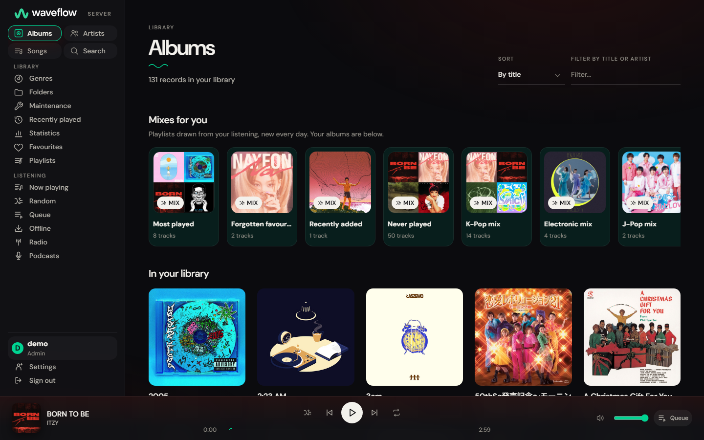
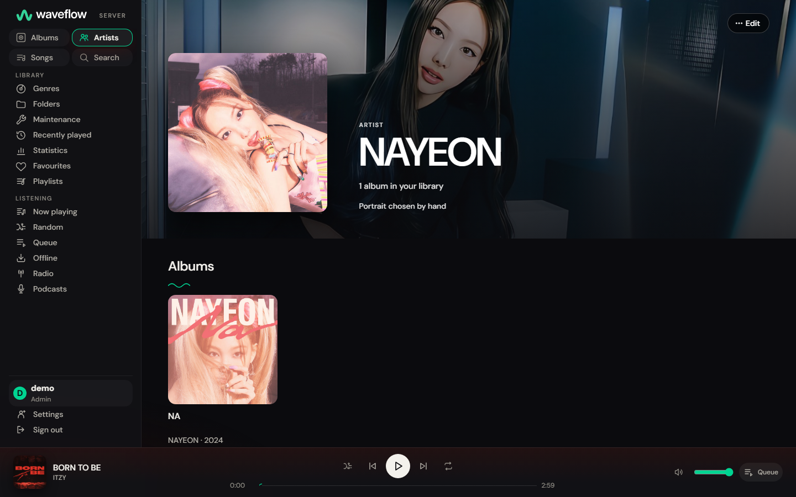
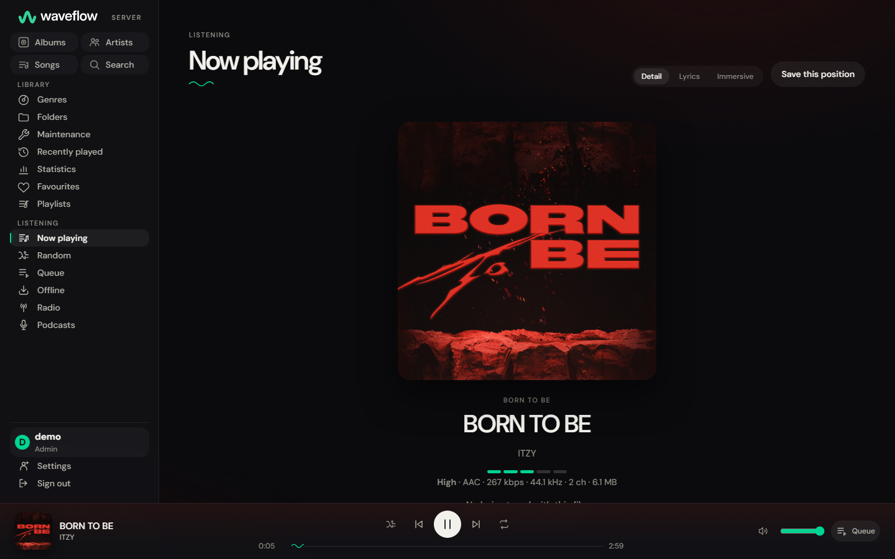
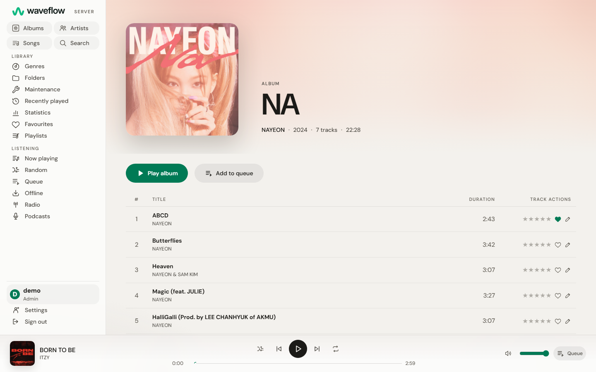
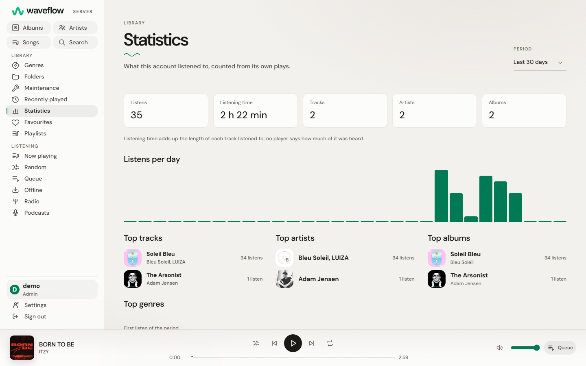
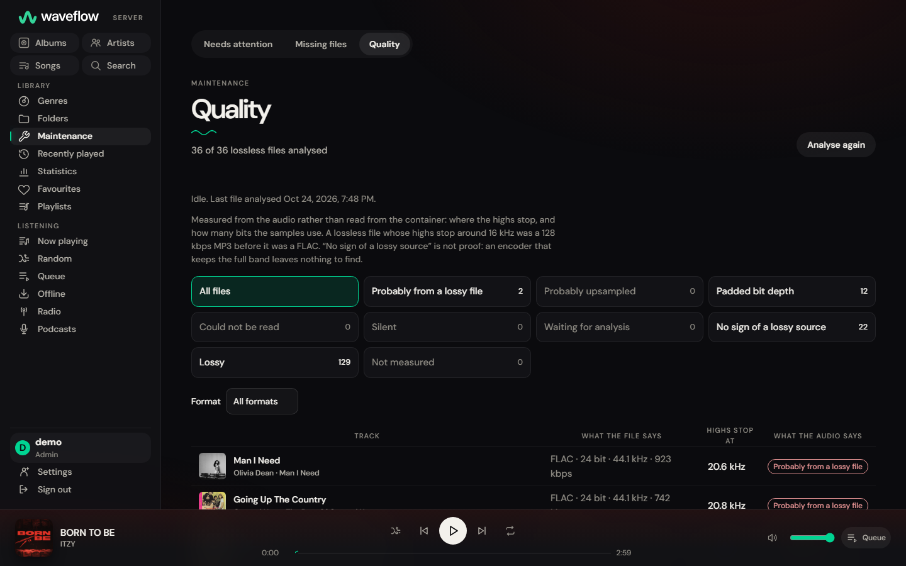

<!-- markdownlint-disable MD033 MD041 -->
<p align="center">
  <picture>
    <source media="(prefers-color-scheme: dark)" srcset="assets/waveflow-logo-horizontal-dark.svg" />
    
  </picture>
</p>

<h1 align="center">WaveFlow Server</h1>

<p align="center">
  <strong>Your music, everywhere you listen.</strong>
  <br />
  A self-hosted music server in one Rust binary — with a web player built in, and the OpenSubsonic API your apps already speak.
</p>

<p align="center">
  
  
  
  
  
  
</p>

<p align="center">
  Point WaveFlow Server at the folders where your music lives. It builds your library, streams it to your browser,
  your phone and your desktop, and converts on the fly when the connection is tight.
  <br />
  No PostgreSQL, no Redis, no identity provider: <b>one binary, one database file, one key file.</b>
  <br />
  <strong>Your files. Your server. Every player.</strong>
</p>

<p align="center">
  <a href="#install"><b>Install</b></a>
  &nbsp;·&nbsp;
  <a href="#features"><b>Features</b></a>
  &nbsp;·&nbsp;
  <a href="#screenshots"><b>Screenshots</b></a>
  &nbsp;·&nbsp;
  <a href="#works-with-your-apps"><b>Apps</b></a>
  &nbsp;·&nbsp;
  <a href="docs/README.md"><b>Documentation</b></a>
  &nbsp;·&nbsp;
  <a href="#development"><b>Develop</b></a>
</p>

<p align="center">
  
  <br />
  <sub><b>The web player</b> · your library, with mixes made from what you actually listen to</sub>
</p>

---

## Why WaveFlow Server

<table>
  <tr>
    <td>📦&nbsp;<b>Up in a minute</b></td>
    <td>One container, on a server, a NAS or a Raspberry Pi 4 or 5. The catalogue lives in a single SQLite file, kept with its key: back up the two together, with the artwork, canvas and podcast folders beside them, as the <a href="docs/guides/operations.md#back-up-two-files-together">operations guide</a> explains.</td>
  </tr>
  <tr>
    <td>📱&nbsp;<b>Your apps already work</b></td>
    <td>Subsonic players connect as they are, with no plugin. Each release is run against Symfonium, Feishin, DSub and Juliet, and the results are <a href="docs/compatibility/subsonic-compatibility.md">published</a>.</td>
  </tr>
  <tr>
    <td>🌐&nbsp;<b>A player in the browser</b></td>
    <td>No app to install: open the server's address and listen, on a desktop or a phone, and keep tracks for when you are offline.</td>
  </tr>
  <tr>
    <td>🔁&nbsp;<b>Nothing moves under you</b></td>
    <td>Album and artist IDs are derived from your tags, so rebuilding the catalogue gives the same IDs back: the links and references your apps hold keep working.</td>
  </tr>
  <tr>
    <td>🔍&nbsp;<b>Knows what your files really are</b></td>
    <td>The audio of every lossless file is measured, and a FLAC that was once an MP3 is shown for what it is.</td>
  </tr>
  <tr>
    <td>🛡️&nbsp;<b>Yours, and only yours</b></td>
    <td>Your audio files are never rewritten. Nothing leaves the server unless you switch it on, and <a href="docs/guides/privacy.md">every outbound request is listed</a>.</td>
  </tr>
</table>

## Features

### 🎧 Listening

- **A complete web player** compiled into the server: albums, artists, songs, genres, folders, search as you type, queue, history and favourites.
- **Mixes** made from your own listening, **listening statistics**, and **similar songs** drawn from your library.
- **Synced lyrics** from the files or their `.lrc`, with a full-screen immersive view; LRCLIB fills the gaps once you switch it on.
- **Streams the original**, or converts on the fly to MP3, Opus or AAC, with seeking inside a conversion and server-side volume levelling (ReplayGain).
- **Offline listening** for the tracks you keep, installable as an app on a phone, keyboard shortcuts, media keys and lock-screen controls.
- **14 themes**, light and dark, in English and French.

### 📚 Your library

- **Scans quickly and keeps up**: only what changed is read again, one damaged folder does not stop the rest, and a watcher picks up new files as they land.
- **Tags or folders**: browse by album and artist, or by the folders on your disk.
- **Thirteen credit roles** (composer, producer, featured artist…), and a joined credit like `Artist A, Artist B` split into two artists when you decide it should be.
- **Missing files keep their data**: favourites, ratings and plays wait for the file to come back. A purge can be undone for a week.
- **Uploads**: a library can accept files sent from a client.

### ✨ Discovery

- **Artist pages** with biographies and similar artists from Last.fm, portraits from Deezer and fanart banners from TheAudioDB, once you opt in.
- **Choose the portrait and the banner yourself**, or let the server find a banner.
- **Smart playlists** that fill themselves from rules, **internet radio** and **podcasts**.

### 📋 Playlists and sharing

- Playlists with repeats, **public playlists** for the other accounts, and **`.m3u` import and export**.
- **Share links** that open a player page in any browser, with an optional expiry and visit limit.
- **Scrobbling** to ListenBrainz, Last.fm and Maloja, through a durable queue that survives restarts and retries a service that is down.

### 🔒 Accounts and safety

- **Several accounts**, each seeing only the libraries it belongs to.
- Argon2id passwords, tokens stored only as hashes, the Subsonic password encrypted with a local key, and sign-in protected against guessing.
- A one-time token guards the first-run setup, so a stranger cannot claim a fresh server.
- **Backups**: `waveflow-server database backup` copies the database and its key together, and the server makes a copy of both before every upgrade.

## Screenshots

<table>
  <tr>
    <td width="50%"></td>
    <td width="50%"></td>
  </tr>
  <tr>
    <td align="center"><sub><b>Artist</b> · a portrait and a banner, chosen or found</sub></td>
    <td align="center"><sub><b>Now playing</b> · with what is actually being streamed</sub></td>
  </tr>
  <tr>
    <td width="50%"></td>
    <td width="50%"></td>
  </tr>
  <tr>
    <td align="center"><sub><b>Album</b> · in one of the light themes</sub></td>
    <td align="center"><sub><b>Statistics</b> · counted from your own plays</sub></td>
  </tr>
  <tr>
    <td colspan="2" align="center"></td>
  </tr>
  <tr>
    <td colspan="2" align="center"><sub><b>Quality</b> · every lossless file measured, not taken at its word</sub></td>
  </tr>
</table>

## Install

**You need** FFmpeg and ffprobe, on `PATH` or beside the `waveflow-server` executable (already in the Docker image). Nothing else: no database server, no cache, no broker.

### Docker

```bash
docker run -d --name waveflow \
  -p 4533:4533 \
  -v waveflow-data:/data \
  -v /path/to/music:/music:ro \
  ghcr.io/instazdll/waveflow-server:2.0.0
```

The image is built for `linux/amd64` and `linux/arm64` (a Raspberry Pi 4 or 5 on a 64-bit system) and published under the same tags on both registries:

| Registry | Image |
| --- | --- |
| GitHub Container Registry | `ghcr.io/instazdll/waveflow-server` |
| Docker Hub | `docker.io/instazdll/waveflow-server` |

Each release is tagged with its version, and `latest` follows the latest stable release.

With Compose, set `WAVEFLOW_MUSIC_PATH` to your music folder, which is mounted read-only:

```bash
WAVEFLOW_MUSIC_PATH=/path/to/music docker compose up -d
```

To reach it from outside your home over HTTPS, [`packaging/caddy/`](packaging/caddy/) runs the same server behind Caddy, which obtains and renews the certificate itself; the [operations guide](docs/guides/operations.md#the-recommended-setup-caddy-in-the-same-compose-file) explains it, including how to move a server already started with the file above without starting over on an empty volume.

### First steps

Open `http://your-host:4533`. The setup screen creates the administrator account; it asks for the one-time token the server wrote in its data directory:

```bash
docker exec waveflow cat /data/setup-token
```

Then add your music under that account (`admin` below), and the first scan starts on its own:

```bash
docker exec waveflow waveflow-server library add --owner admin --name Music --path /music
```

<details>
<summary>From the command line instead of the browser</summary>

```bash
docker exec -e WAVEFLOW_ACCOUNT_PASSWORD='at-least-twelve-characters' \
  waveflow waveflow-server account create-admin --username admin
```

</details>

### Connect a Subsonic app

Subsonic apps use a **dedicated password**, separate from the web one:

```bash
docker exec -e WAVEFLOW_SUBSONIC_PASSWORD='a-different-app-password' \
  waveflow waveflow-server credential set --actor admin --username admin
```

On your own network, point your app at `http://your-host:4533` with that username and password. The server speaks plain HTTP, and Subsonic apps send their credentials with every request: `-p 4533:4533` above publishes it on every interface of the host, which suits a network you trust and nothing wider. To listen from outside, put it behind a reverse proxy that terminates TLS, give your apps its `https://` address, and set `WAVEFLOW_PUBLIC_URL` to it. The [operations guide](docs/guides/operations.md#behind-a-reverse-proxy-generally) says how to publish the port when a proxy sits in front, and has the rest, including backups and the instance key.

<details>
<summary>From source</summary>

Requires **Rust 1.98+** and [bun](https://bun.sh).

```bash
bun --cwd=webapp install
bun run build              # the web player first, then the server: the order matters

export WAVEFLOW_ACCOUNT_PASSWORD='at-least-twelve-characters'
cargo run -- account create-admin --username admin
cargo run -- library add --owner admin --name Music --path /path/to/music
cargo run
```

</details>

## Works with your apps

Each release is checked against real clients, and every result is read back from the server rather than from what the app displayed. The last run was on 2026-10-27 and 2026-10-28:

| App | Tested on | What it was seen doing |
| --- | --- | --- |
| **Symfonium** | Android | Browse, seek in every format, favourites, ratings, bookmarks, lyrics |
| **Feishin** | Windows desktop | Browse, folders, synced lyrics, radio, playlists |
| **DSub** | Android | Folders, podcasts, play queue, playlists, sharing |
| **Juliet** | iPhone | Browse, transcoding, play queue, playlists |
| **[WaveFlow Desktop](https://github.com/InstaZDLL/WaveFlow)** | Windows, macOS, Linux | Syncs your library and listening across devices, through the native API |

What each app does and does not use, and where an app has a limitation of its own, is in the [compatibility matrix](docs/compatibility/subsonic-compatibility.md).

## Documentation

| | |
| --- | --- |
| **Run it** | [Operations](docs/guides/operations.md): setup, backups, the instance key, reverse proxies, optional features · [Privacy](docs/guides/privacy.md): every host the server can contact |
| **Build a client** | [Native API v2](docs/guides/api-v2-guide.md) · [Subsonic / OpenSubsonic](docs/guides/subsonic-api-guide.md) · the interactive reference at `/reference` on any server |
| **What changed** | [CHANGELOG](CHANGELOG.md) |
| **Everything else** | The [documentation index](docs/README.md): the compatibility matrix, the design RFCs, the plans |

## How it works

| | |
| --- | --- |
| **One process** | `src/main.rs` loads the settings and serves; everything else sits behind `app()` in `src/app/router.rs`, so the test suite drives the very router `main` serves |
| **One database** | SQLite in WAL mode with foreign keys and a single writer. Migrations are dated, embedded at compile time and checksummed |
| **One catalogue, three surfaces** | The native API, the Subsonic API and the web player call the same domain services, so they cannot drift apart |
| **Privacy in the query** | Access is checked inside the SQL, through library membership. Something missing and something belonging to another account answer the same `404` |
| **Read-only files** | The scanner and every tag operation leave your audio files untouched |

Built with axum, SQLite through sqlx, FFmpeg, lofty, React 19 and Vite, compiled into the binary with rust-embed. [RFC-002](docs/rfcs/RFC-002-waveflow-server-v2.md) is the design.

## Development

```bash
cargo fmt --all --check
cargo clippy --all-targets --all-features -- -D warnings
cargo test --all-features          # hermetic: temporary SQLite databases, no service to start

bun --cwd=webapp run test
bun --cwd=webapp x playwright install chromium
bun --cwd=webapp run test:e2e
```

FFmpeg and ffprobe must be on `PATH`, since the suite drives a real media service. Commits need a DCO sign-off (`git commit -s`) and a Conventional Commit message. [CONTRIBUTING.md](CONTRIBUTING.md) has the rest, and [CLAUDE.md](CLAUDE.md) the conventions in depth.

## Community

- 🐛 **Bug?** → [Bug report](https://github.com/InstaZDLL/waveflow-server/issues/new?template=bug_report.yml)
- ✨ **Idea?** → [Feature request](https://github.com/InstaZDLL/waveflow-server/issues/new?template=feature_request.yml)
- 🔒 **Security?** → [Private disclosure](.github/SECURITY.md), never a public issue.

English and French are both welcome.

## Related

- [**WaveFlow**](https://github.com/InstaZDLL/WaveFlow): the desktop player, which syncs with this server.
- [**WaveFlow QuickPlay**](https://github.com/InstaZDLL/waveflow-quickplay): a tiny player for the file in front of you.

## License

WaveFlow Server is licensed under [**AGPL-3.0-only**](LICENSE): it runs as a network service, so anyone you serve it to is entitled to its source. The desktop application and `waveflow-core` are GPL-3.0-only.

The WaveFlow logo, its favicons and app icons come unchanged from the logo kit kept with the [desktop application](https://github.com/InstaZDLL/WaveFlow) under `design/logo/`, whose usage guide governs them. The wordmark is Inter SemiBold converted to outlines; Inter is under the SIL Open Font License 1.1, which permits its use in a logo.

The screenshots show albums and artist photos from the maintainer's own library, used for illustration only.
